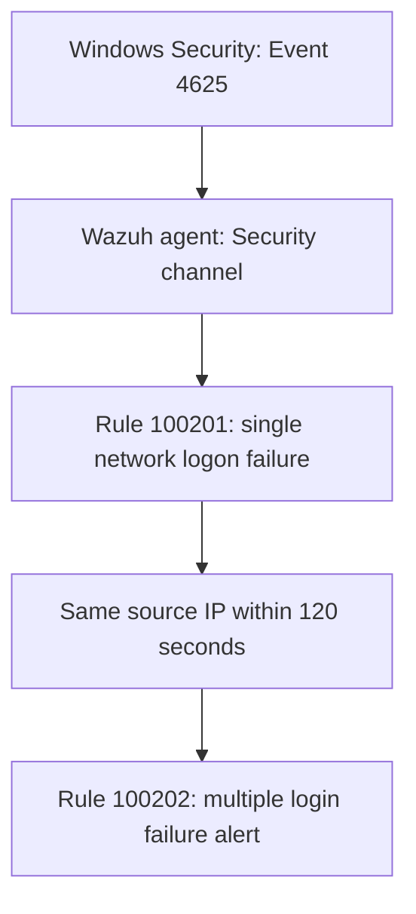
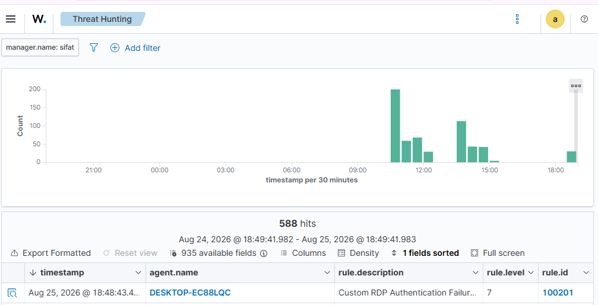
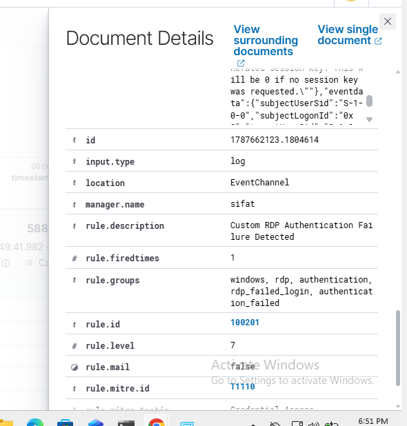
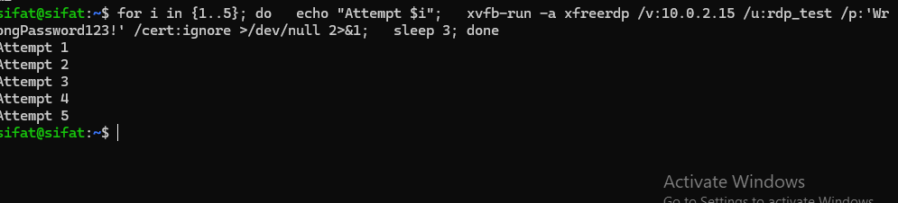
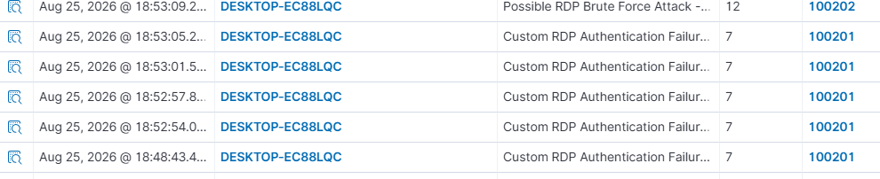
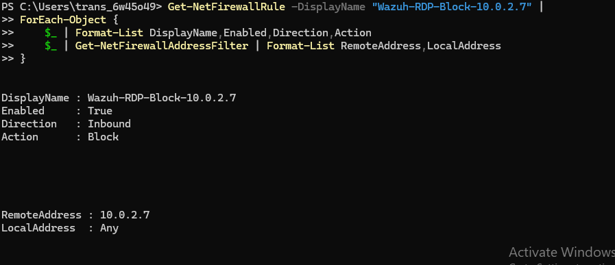
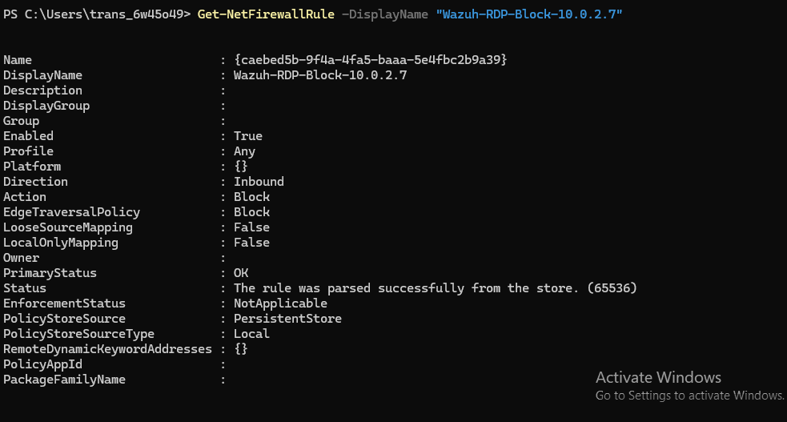

# Multiple Login Failure Detection Using Wazuh

A defensive detection engineering lab that identifies repeated Windows authentication failures from the same source IP using Wazuh SIEM.

## Objective

Collect Windows Security Event ID **4625**, detect an individual network logon failure, and raise a higher-severity alert when failures repeat from the same source within a **120-second** window.

The lab's configured correlation threshold is **5**. This project uses **Multiple Login** as its title; the implemented rule specifically filters **Logon Type 3 (Network)**. It does not detect every Windows logon type or prove which service caused a failure.

## Detection flow

## Screenshot walkthrough

These six original screenshots were extracted from the author's implementation report. Follow the numbered steps to see how login failures become a higher-severity alert.

The images retain the historical lab's RDP labels and test commands. The project title remains **Multiple Login Failure Detection Using Wazuh**. Images show historical results, not a fresh execution of the revised repository rules.

### 1. Check that events appear in Wazuh

**Look at:** the event timeline, the results table, and the **100201** rule ID.

**What it means:** the endpoint's events reached Wazuh and a custom single-failure alert is visible. The **588 hits** value is the dashboard's selected result count; it is not proof of 588 failed logins in one attack.

### 2. Open a single login-failure alert

**Look at:** **rule.id = 100201**, **rule.level = 7**, and the rule description.

**What it means:** Wazuh identified one qualifying network authentication failure. A single wrong password does not establish a brute-force attack. This image shows alert details; it is not a Windows Event Viewer screenshot of Event 4625.

### 3. Generate controlled failed authentications in the lab

**Look at:** the output **Attempt 1** through **Attempt 5**.

**What it means:** the test source ran five deliberate attempts against a dedicated lab endpoint. The original screenshot uses a remote desktop client as the test transport. Terminal output alone does not prove five events were collected; verify the Windows events and Wazuh alerts as well.

### 4. Find the multiple-login alert

**Look at:** **100202** with severity **12**, alongside earlier **100201** alerts with severity **7**.

**What it means:** the historical lab produced a higher-severity correlation alert after repeated failures. Compare source addresses and timestamps in the full event details to verify the same-IP, 120-second condition; the list view alone does not display all those fields.

### 5. Inspect the historical firewall block

**Look at:** **Enabled: True**, **Direction: Inbound**, **Action: Block**, and **RemoteAddress: 10.0.2.7**.

**What it means:** the historical Windows endpoint had an enabled firewall block for that lab source. This is evidence of the rule's presence, not proof by itself that Wazuh created it automatically or that traffic was blocked in a connection test.

### 6. Check the detailed firewall state

**Look at:** the rule's display name, enabled state, action, and the successful policy-store status.

**What it means:** Windows accepted the firewall rule into its policy store. The repository currently provides detection only; the original response integration needs the fixes described in [Response notes](docs/RESPONSE.md). These screenshots do not demonstrate timed removal or a complete add/delete response workflow.

For commands to reproduce and verify the detection, continue to [Setup and verification](docs/SETUP.md).

## Lab environment

| Component | Recorded lab configuration |
| --- | --- |
| Wazuh manager | Ubuntu 24.04, Wazuh 4.14.5 |
| Windows endpoint | Windows 11, agent 002 |
| Test source | Ubuntu VM |
| Windows event | Security Event ID 4625 |
| Observed authentication | NTLM, Logon Type 3 |
| Base rule | 60122 |
| Single failure | 100201, level 7 |
| Repeated failures | 100202, level 12 |

These are historical lab details from the author's implementation report, not requirements for all installations. Confirm field names and base-rule behavior on your installed Wazuh version.

## Repository contents

- [Detection rules](rules/multiple_login_rules.xml)
- [Windows event collection snippet](config/windows-security-collection.xml)
- [Setup and verification](docs/SETUP.md)
- [Response notes and limitations](docs/RESPONSE.md)
- [Synthetic sample event](examples/failed-login.json)

## Quick start

1. Enable Windows Logon failure auditing and verify Event 4625 is generated.
2. Confirm the Wazuh agent collects the Security event channel.
3. Install the custom rules on the manager.
4. Validate the manager configuration, then restart it.
5. Perform controlled failed authentications using a dedicated lab account.
6. Verify rules 100201 and 100202 and inspect the source IP.

See [SETUP.md](docs/SETUP.md) for commands and the verification checklist.

## Rule logic

| Rule | Conditions | Result |
| --- | --- | --- |
| 100201 | Base rule 60122; Event 4625; Logon Type 3; nonempty, non-placeholder source address | Single network login failure |
| 100202 | Historical matches of 100201; same source IP; frequency 5; timeframe 120 | Possible brute-force activity |

Wazuh normally correlates frequency events within the same agent unless global frequency is enabled. This repository does not enable global correlation.

Repeated failures indicate suspicious activity, not a confirmed compromise. Stale credentials, saved passwords, scanners, and user mistakes can produce similar events. An IP shared by multiple users can aggregate their failures.

## Validation status

The author's original report records single-failure alerts, a multiple-failure alert, and a Windows firewall block. This repository is a cleaned-up reconstruction of that workflow, with neutral project naming and source-address filtering.

**The repository's revised files have not been executed against a live Windows/Wazuh environment in this publishing session.** Validate actual threshold behavior and event decoding before deployment. The sample JSON is synthetic and is not evidence of a successful live run.

Automatic firewall response is documented as follow-up work; this repository does not ship or enable an unverified blocking integration.

## MITRE ATT&CK

**T1110 — Brute Force** describes the behavior investigated by the repeated-failure alert. The alert alone does not establish password guessing, credential stuffing, or successful access.

## References

- [Wazuh rule syntax](https://documentation.wazuh.com/current/user-manual/ruleset/ruleset-xml-syntax/rules.html)
- [Wazuh custom rules](https://documentation.wazuh.com/current/user-manual/ruleset/rules/custom.html)
- [Microsoft: Event 4625](https://learn.microsoft.com/en-us/windows/security/threat-protection/auditing/event-4625)
- [MITRE ATT&CK: T1110](https://attack.mitre.org/techniques/T1110/)

Use controlled tests only on systems you own or are authorized to assess.
